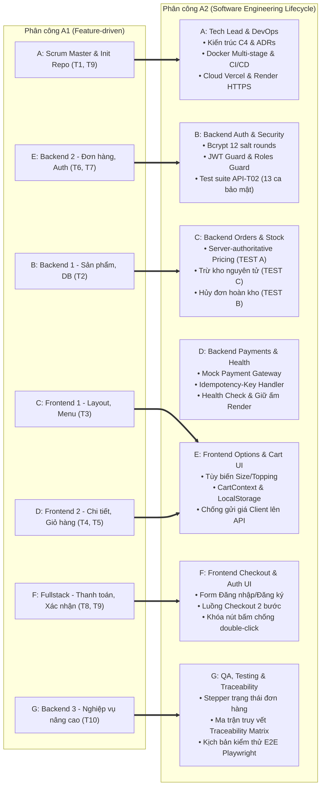

# BẢN ĐỒ HỢP NHẤT TOÀN DIỆN: KẾ THỪA TỪ BREWLITE A1 LÊN BREWLITE A2
## (Comprehensive Synthesis: The Evolution from Assignment 1 to Assignment 2)

> **Căn cứ tài liệu:**
> 1. Đề bài chính thức: *BrewLite – Assignment 2: Requirements to Deployment (VER 1.0 – SGU)*
> 2. Tài liệu gốc A1: *BrewLite – Hướng dẫn thực hiện chi tiết cho nhóm 7 người (VER 1.0 – SGU)*

---

## 1. CÂU TRẢ LỜI CHO BẠN: "CÓ PHẢI BAO GỒM CẢ A1 VÀ A2 KHÔNG?"

> **CÂU TRẢ LỜI LÀ: CHÍNH XÁC 100%! BẮT BUỘC PHẢI BAO GỒM CẢ HAI.**

Đề bài Assignment 2 khẳng định ngay tại **Dòng 1, Mục 1 (Trang 3)**:
> *"Assignment 2 tiếp tục sử dụng đề tài BrewLite của Assignment 1. Nhóm phải phát triển dự án theo một chuỗi công việc hoàn chỉnh, bắt đầu từ khai thác yêu cầu, mô hình hóa và thiết kế kiến trúc, sau đó hiện thực qua hai Sprint, thiết lập CI/CD và triển khai hệ thống lên môi trường có thể truy cập được."*

### Mối quan hệ biện chứng giữa A1 và A2:
* **A1 là "Phần thịt" (Code & Feature-First):** Xây dựng các module tính năng cốt lõi (10 Task: T1 $\to$ T10), code chạy được ở local qua Docker Compose.
* **A2 là "Bộ xương & Quy trình" (Engineering & Process-First):** Lấy toàn bộ mã nguồn của A1 làm nguyên liệu, nhưng **tái cấu trúc thành Monorepo**, lập **Tài liệu chuẩn mực 5 Task**, thiết lập **Ma trận truy vết (Traceability Matrix)**, chạy **CI/CD tự động** và đưa lên **Cloud Production thật có HTTPS**.

---

## 2. BẢNG ÁNH XẠ 10 TASK CỦA A1 SANG 5 TASK CỦA A2

Toàn bộ 10 Task phân công cho 7 thành viên trong A1 được kế thừa và sắp xếp lại một cách khoa học vào 5 Task lớn của A2:

| Task trong A1 (Đặc tả 10 Task) | Người làm | Nội dung kỹ thuật gốc | Thuộc Task nào trong A2? | Tạo phẩm nghiệm thu tương ứng trong A2 |
| :--- | :---: | :--- | :--- | :--- |
| **Task 1:** Khởi tạo dự án & Git | **A** | `create-next-app`, `@nestjs/cli`, `.env.example` | **Task 4.1 & Task 4.2** | Monorepo `apps/web`, `apps/api`, `.gitignore`, `README.md`. |
| **Task 2:** Schema DB & Seed | **B** | Prisma init, model Product, User, seed 4 món | **Task 4.3 (Sprint 1)** | `schema.prisma`, `prisma/seed.ts`, migrations. |
| **Task 3:** Menu Layout & API | **C** | `GET /products`, UI Grid 4 cột, loading/empty/error | **Task 4.3 (Sprint 1)** | `apps/web/app/page.tsx`, `menu.test.tsx` (`WEB-T01`). |
| **Task 4:** Chi tiết món & Phụ thu | **D** | Chọn size S/M/L, Topping trân châu/kem, tính nhẩm giá | **Task 5.1 (Sprint 2)** | `ProductOptionSelector.tsx`, `cart.test.tsx` (`WEB-T02`). |
| **Task 5:** Giỏ hàng & LocalStorage | **D** | Store Zustand, gộp dòng, tính tổng tiền | **Task 5.1 (Sprint 2)** | `CartContext.tsx`, `cart/page.tsx` (`WEB-T03`). |
| **Task 6:** API Đặt hàng Server | **E** | `POST /orders`, DTO validation, tự tính giá DB | **Task 5.1 & Task 5.2** | `orders.service.ts`, `orders.security.spec.ts` (**TEST A**). |
| **Task 7:** Xác thực Auth & JWT | **E** | `POST /auth/register`, `login`, Bcrypt, JWT Guard | **Task 5.1 (Sprint 2)** | `auth.service.ts`, `auth.security.spec.ts` (`API-T02`). |
| **Task 8:** Thanh toán giả lập | **F** | `MockGatewayService`, `POST /payments` | **Task 5.1 (Sprint 2)** | `payments.service.ts`, `mock-gateway.service.ts`. |
| **Task 9:** Lịch sử đơn & Docker | **A + F** | `GET /orders/me`, Stepper UI, `docker-compose.yml` | **Task 5.1 & Task 5.3** | `orders/page.tsx`, `docker-compose.yml`, Dockerfile. |
| **Task 10.1:** State Machine đơn | **G** | `order-state.ts`, chặn nhảy cóc trạng thái | **Task 5.2 (Kiểm thử)** | `orders.service.ts` (L300+), `orders.controller.spec.ts`. |
| **Task 10.2:** Thanh toán Idempotent | **G** | `Idempotency-Key` UUID, chặn trừ tiền 2 lần | **Task 5.2 & Task 3.1** | `payments.service.ts`, ADR-005. |
| **Task 10.3:** Concurrency kho | **G** | Optimistic locking / Atomic conditional update | **Task 5.2 (Kiểm thử)** | **TEST C** trong `lecturer-audit-report.md`. |
| **Task 10.4:** Khuyến mãi / Loyalty | **G** | Coupon GIAM10, điểm thưởng tích lũy | **Task 1.2 & Mục 8** | **FR-08 DEFERRED** (Hoãn theo `api-contracts.md`). |

---

## 3. SỰ CHUYỂN DỊCH VAI TRÒ CỦA 7 THÀNH VIÊN (A $\to$ G)

Trong tài liệu A1, mỗi người chịu trách nhiệm một vài file code. Sang A2, mỗi người phụ trách một **khối năng lực Kỹ nghệ phần mềm**:



---

## 4. BỐN ĐIỂM "LỘT XÁC" TỪ A1 LÊN A2 BẠN CẦN NÓI TRƯỚC HỘI ĐỒNG

Khi Thầy Cô hỏi: *"Đồ án A2 này khác gì so với A1 tụi em đã làm trước đây?"*, hãy trả lời bằng **4 điểm đột phá**:

### 1. Đột phá về Kiến trúc (Architecture Evolution)
* **A1:** Thư mục rời rạc `frontend/` và `backend/`, dependencies cài 2 lần độc lập, không có cơ chế chia sẻ type chuẩn hóa.
* **A2:** Chuyển đổi thành **Monorepo chuẩn npm workspaces** (`apps/web` và `apps/api`). Tài liệu hóa thành **5 quyết định kiến trúc chính thức (ADR 001 $\to$ 005)**.

### 2. Đột phá về Tính toàn vẹn dữ liệu (Data Integrity & Concurrency)
* **A1:** Dùng Optimistic Locking với vòng lặp `for attempt < 3` (dễ bị nghẽn mạng và timeout khi tải cao).
* **A2:** Nâng cấp lên **Atomic Conditional Update** trực tiếp trong câu lệnh SQL:
  ```sql
  UPDATE "Product" SET "stockQuantity" = "stockQuantity" - :qty 
  WHERE "id" = :id AND "stockQuantity" >= :qty AND "isAvailable" = true;
  ```
  Xử lý triệt để tranh chấp đồng thời của 2 khách mua ly cuối cùng mà không cần vòng lặp retry.

### 3. Đột phá về Tính truy vết (Traceability – Mục 8.1 đề bài)
* **A1:** Chưa có ma trận truy vết; các tính năng được code tự do.
* **A2:** Thiết lập **Bảng Ma trận Truy vết hai chiều (`docs/traceability-matrix.md`)**:
  $$\text{Yêu cầu (FR/NFR)} \Longleftrightarrow \text{Use Case} \Longleftrightarrow \text{Sơ đồ UML} \Longleftrightarrow \text{Mã nguồn API} \Longleftrightarrow \text{Bài Test}$$

### 4. Đột phá về Đóng gói & Triển khai Thực tế (Production Delivery)
* **A1:** Chỉ chạy cục bộ qua Docker Compose tại `localhost:3000` và `localhost:3001`.
* **A2:** Triển khai **Cloud Production thực tế 100% có chứng chỉ bảo mật HTTPS (SSL/TLS 1.3)**:
  * Frontend Web: [https://brewlite-a2.vercel.app](https://brewlite-a2.vercel.app) (Vercel Edge Network).
  * Backend API: [https://brewlite-a2.onrender.com](https://brewlite-a2.onrender.com) (Render Docker Container).
  * Endpoint Giám sát: [https://brewlite-a2.onrender.com/health](https://brewlite-a2.onrender.com/health).
  * Pipeline CI/CD tự động 4 bước và GitHub Actions Cron giữ ấm máy chủ 24/7.

---

## 5. KỊCH BẢN MỞ ĐẦU CHẠM ĐẾN TRÁI TIM GIẢNG VIÊN (90 GIÂY)

> *"Kính thưa Hội đồng, đồ án BrewLite của nhóm em được xây dựng trên nguyên tắc kế thừa và hoàn thiện toàn diện từ Assignment 1 lên Assignment 2.*  
> 
> *Ở Assignment 1, nhóm đã tập trung xây dựng nền tảng chức năng của 10 Task cốt lõi: từ danh mục sản phẩm, giỏ hàng, xác thực JWT đến thanh toán mô phỏng có Idempotency.*  
> 
> *Bước sang Assignment 2, tuân thủ nghiêm ngặt đề bài của Bộ môn, nhóm đã **chuyển dịch từ tư duy lập trình đơn thuần (Code-first) sang quy trình Kỹ nghệ phần mềm chuyên nghiệp (Engineering-first)** với 5 Task tuần tự: Khai thác yêu cầu SRS $\to$ Mô hình hóa sơ đồ UML $\to$ Thiết kế kiến trúc với 5 ADRs $\to$ Triển khai 2 Sprint Agile $\to$ Đóng gói CI/CD và Triển khai Cloud trực tuyến có HTTPS.*  
> 
> *Toàn bộ hệ thống được kết nối chặt chẽ qua **Ma trận truy vết hai chiều** và được bảo vệ bởi **Bộ kiểm thử 128 tests pass 100%**, giải quyết triệt để các bài toán khó về chống sửa giá client, hủy đơn hoàn kho an toàn và tranh chấp tồn kho đồng thời. Sau đây em xin phép bắt đầu phần trình bày chi tiết ạ!"*
