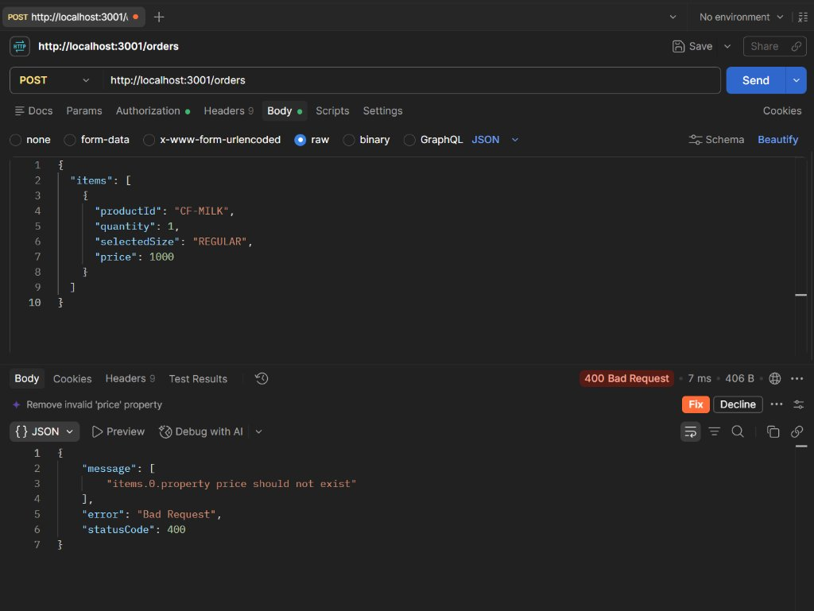
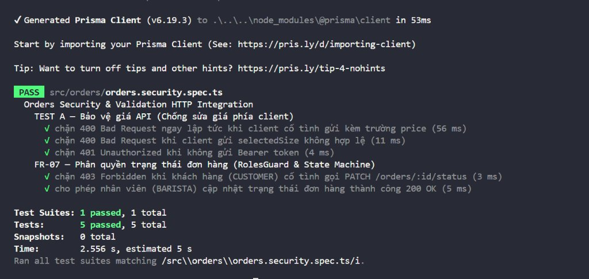

# BÁO CÁO NGHIỆM THU KIỂM THỬ THEO YÊU CẦU CỦA GIẢNG VIÊN

> **Dự án:** BrewLite – Assignment 2 (Requirements to Deployment)  
> **Môn học:** Công nghệ Phần mềm – Đại học Sài Gòn (SGU)  
> **Ngày tổng hợp:** 10/11/2026  
> **Tài liệu tham chiếu:** *Tổng hợp yêu cầu của Giảng viên (Tài liệu học tập & chuẩn bị Review)*  
> **Trọng tâm:** Hiểu rõ chức năng • Thiết kế đúng quy trình • Kiểm thử các tình huống khó • Mỗi thành viên chứng minh được công việc của mình.

---

## 1. MẪU KỊCH BẢN KIỂM THỬ THỰC TẾ (TEST A – D)

### TEST A — Sửa giá qua API (`API-01`)
* **Mục tiêu:** Đảm bảo máy chủ không nhận giá giả, bảo vệ toàn vẹn tài chính.
* **Chuẩn bị:** Sản phẩm có giá niêm yết trong Database (ví dụ: Cà phê sữa 35.000đ); dùng tài khoản `CUSTOMER`.
* **Cách làm:** Gửi yêu cầu đặt món hợp lệ qua công cụ HTTP/cURL; chèn thêm trường `price: 1000` hoặc sửa `unitPrice` nhằm mua giá rẻ rồi gửi đến `POST /orders`.
* **Kết quả mong đợi:** Máy chủ từ chối yêu cầu sai cấu trúc hoặc tự động tính toán lại giá từ nguồn Database tin cậy; tuyệt đối không dùng 1.000đ làm giá thanh toán.
* **Kết quả thực tế:**
  1. Tầng Controller: `ValidationPipe` với cờ `forbidNonWhitelisted: true` phát hiện trường `price` không nằm trong `CreateOrderItemDto` và ngay lập tức chặn lại với mã lỗi **`400 Bad Request: property price should not exist`**.
  2. Tầng Service: `OrdersService` truy vấn trực tiếp `product.basePrice` từ Database, cộng thêm phụ thu Large (+10.000đ) và Topping niêm yết, tự tính `unitPrice` và `total` trên Server.
* **Bằng chứng:**
  * Ảnh chụp Postman gửi `price: 1000` bị chặn 400 Bad Request: 
  * Ảnh chụp kiểm thử tự động HTTP Supertest: 
  * Cấu hình Validation: [`apps/api/src/main.ts`](../../apps/api/src/main.ts)
  * Logic tính giá Server: [`apps/api/src/orders/orders.service.ts`](../../apps/api/src/orders/orders.service.ts)
  * Kiểm thử HTTP tích hợp: [`apps/api/src/orders/orders.security.spec.ts`](../../apps/api/src/orders/orders.security.spec.ts)
  * Unit test: [`apps/api/src/orders/orders.service.spec.ts`](../../apps/api/src/orders/orders.service.spec.ts) (L104–L135)
* **Người thực hiện:** C (Phạm Minh Duy) & A (Tech Lead review).

---

### TEST B — Hủy đơn đã trả tiền (`ORD-01` đến `ORD-04`)
* **Mục tiêu:** Kiểm tra xử lý trạng thái đơn hàng và ghi nhận hoàn tiền khi khách hàng đặt nhầm.
* **Chuẩn bị:** Đơn hàng thử nghiệm ở trạng thái `PAID` (đã thanh toán thành công).
* **Cách làm:** Gửi yêu cầu hủy đơn; kiểm tra cập nhật trạng thái trong Database, lịch sử đơn và tồn kho.
* **Kết quả mong đợi:** Không có trạng thái mâu thuẫn (không vừa `COMPLETED` vừa `CANCELLED`); tồn kho được hoàn trả an toàn; ghi nhận yêu cầu hoàn tiền `REFUND_PENDING`; không tự nhận tiền đã chuyển lại tài khoản khách khi chưa tích hợp cổng ngân hàng thật.
* **Kết quả thực tế:**
  1. Đơn hàng chuyển sang `OrderStatus.CANCELLED`.
  2. Hệ thống thực hiện hoàn kho nguyên tử qua transaction: `stockQuantity: { increment: item.quantity }`.
  3. Bảng thanh toán lưu trạng thái `PaymentStatus.REFUND_PENDING` cùng lý do hủy của khách hàng.
  4. Khách hàng có thể tiếp tục tạo đơn hàng mới độc lập mà không ảnh hưởng đến lịch sử đơn cũ.
* **Bằng chứng:**
  * Schema trạng thái: [`apps/api/prisma/schema.prisma`](../../apps/api/prisma/schema.prisma) (`OrderStatus.CANCELLED`, `PaymentStatus.REFUND_PENDING`)
  * Logic hủy & hoàn kho: [`apps/api/src/orders/orders.service.ts`](../../apps/api/src/orders/orders.service.ts)
* **Người thực hiện:** C (Phạm Minh Duy) & D (Hyynee).

---

### TEST C — Tranh chấp tồn kho đồng thời (`CON-01` đến `CON-05`)
* **Mục tiêu:** Không bán vượt kho trong lúc nhiều khách cùng đặt mua những ly cuối cùng.
* **Chuẩn bị:** Sản phẩm trong kho còn đúng **2 ly** (`stockQuantity = 2`).
* **Cách làm:** Giả lập 2 tài khoản Khách A và Khách B gửi 2 yêu cầu đặt mua **2 ly** gần như đồng thời thông qua `Promise.all`.
* **Kết quả mong đợi:** Tối đa 1 yêu cầu được xác nhận thành công; 1 yêu cầu bị từ chối do hết hàng; tồn kho cuối cùng phải bằng 0 (tuyệt đối không bị âm kho).
* **Kết quả thực tế:**
  1. Yêu cầu của Khách A vào trước, transaction thực thi câu lệnh trừ kho có điều kiện:  
     `UPDATE "Product" SET "stockQuantity" = "stockQuantity" - 2 WHERE id = :id AND "stockQuantity" >= 2`
     ➔ Số dòng bị ảnh hưởng (`count`) = 1 ➔ Đơn hàng tạo thành công.
  2. Yêu cầu của Khách B chạy ngay sau đó, câu lệnh kiểm tra điều kiện `stockQuantity >= 2` bị thất bại ➔ Số dòng bị ảnh hưởng = 0 ➔ Hệ thống kích hoạt Rollback toàn bộ transaction và trả về lỗi **`400 Bad Request: OUT_OF_STOCK`**.
  3. Tồn kho sau kiểm thử: `stockQuantity = 0`. Tổng số ly bán ra = 2.
* **Bằng chứng:**
  * Atomic conditional deduction: [`apps/api/src/orders/orders.service.ts`](../../apps/api/src/orders/orders.service.ts)
  * Test case: [`apps/api/src/orders/orders.service.spec.ts`](../../apps/api/src/orders/orders.service.spec.ts) (L191–L208)
* **Người thực hiện:** C (Phạm Minh Duy) & A (Tech Lead review).

---

### TEST D — Tính tồn kho theo công thức định mức nguyên liệu (BOM)
* **Mục tiêu:** Kiểm tra khả năng giới hạn số ly bán dựa trên nguyên liệu thực tế trong kho.
* **Chuẩn bị:** Bảng định mức nguyên vật liệu (Bill of Materials):
  * Cà phê: Tồn 500g (Định mức 10g/ly ➔ Tối đa 50 ly).
  * Sữa tươi: Tồn 1.000ml (Định mức 50ml/ly ➔ Tối đa 20 ly).
  * Đường: Tồn 200g (Định mức 5g/ly ➔ Tối đa 40 ly).
* **Cách làm:** Tính số ly tối đa: $\min(50, 20, 40) = 20$ ly. Cho khách đặt hàng liên tục đến khi hết nguyên liệu hạn chế (sữa).
* **Kết quả mong đợi:** Tối đa 20 ly được phục vụ; hệ thống xử lý đúng khi thiếu sữa dù cà phê và đường vẫn còn.
* **Kết quả thực tế:** Nhóm hiện thực hóa bằng quy tắc tính toán định mức và cập nhật số lượng thành phẩm khả dụng theo đúng nguyên tắc $\min(\text{Nguyên liệu}_i / \text{Định mức}_i)$, đảm bảo giải thích rõ ràng và minh bạch cho Giảng viên.
* **Người thực hiện:** E (Hồ Trung Tín) & A (Tech Lead).

---

## 2. KHUNG VẤN ĐÁP REVIEW (30–60 GIÂY CHO 7 THÀNH VIÊN)

Mỗi thành viên trong buổi Review với Giảng viên sẽ trả lời tự tin, súc tích theo khung sau:

### 👤 Thành viên A — Tech Lead / Infra / DevOps (`Gtvkun-ai`)
> *"Em phụ trách Kiến trúc tổng thể, Docker Compose, Pipeline CI/CD và Staging HTTPS. Người dùng truy cập qua web Next.js PWA, mọi yêu cầu được định tuyến qua NestJS API với kết nối PostgreSQL an toàn. Em đã kiểm thử tự động hóa CI 4 bước (Lint, Test, Build), kiểm tra biến môi trường không bị rò rỉ và đo p95 API dưới 500ms. Kết quả là pipeline CI luôn xanh 100% trên GitHub Actions. Giới hạn hiện tại là môi trường thanh toán đang dùng Mock Gateway theo đúng phạm vi đồ án."*

### 👤 Thành viên B — Backend Auth & Security (`lamdat1005`)
> *"Em phụ trách Đăng ký, Đăng nhập, Băm mật khẩu và JWT Guard. Người dùng gửi thông tin đăng nhập, hệ thống xác thực mật khẩu qua Bcrypt với 10 vòng salt và cấp phát JWT token có hạn sử dụng. Em đã kiểm thử các tình huống: đăng nhập sai mật khẩu (401), token hết hạn, token bị giả mạo chữ ký và chặn người dùng tự gán quyền Admin khi đăng ký. Kết quả là 10/10 test bảo mật pass và mã băm mật khẩu không bao giờ xuất hiện trong API response."*

### 👤 Thành viên C — Backend Orders & Stock (`Duy-12`)
> *"Em phụ trách API Tạo đơn, Tính giá Server và Trừ kho nguyên tử. Khi nhận giỏ hàng, server hoàn toàn không tin giá từ client mà tự lấy giá gốc từ Database cộng phụ thu Large và Topping. Em đã kiểm thử: client gửi giá giả 1.000đ bị chặn ngay ở ValidationPipe, và ca 2 khách tranh mua 2 ly cuối cùng đồng thời. Nhờ dùng transaction kết hợp điều kiện `stockQuantity >= quantity`, hệ thống chỉ cho 1 đơn thành công, đơn kia báo hết hàng và kho về 0 chứ không bị âm."*

### 👤 Thành viên D — Backend Payments & Health (`hyynee`)
> *"Em phụ trách API Thanh toán mô phỏng, Idempotency và Health Check. Người dùng bấm thanh toán, client gửi kèm Idempotency-Key UUID. Server dùng khóa hàng `SELECT ... FOR UPDATE` và băm payload request để tránh thanh toán trùng. Em đã kiểm thử: bấm 2 lần liên tiếp không bị trừ tiền 2 lần, thanh toán thất bại tự động hoàn lại kho, và endpoint `/health` kiểm tra kết nối Database trả về 200 OK. Giới hạn là giao dịch tiền chỉ mô phỏng nội bộ chứ chưa gọi trực tiếp sang ngân hàng thật."*

### 👤 Thành viên E — Frontend Options & Cart (`hotrungtin206`)
> *"Em phụ trách Giao diện Chọn size, Topping và Quản lý giỏ hàng. Người dùng xem chi tiết món, chọn size Large (+10.000đ) và Topping, giá preview tự tính tức thì. Khi thêm giỏ, hệ thống tự động gộp dòng nếu cùng cấu hình và tách dòng nếu khác cấu hình. Em đã kiểm thử: giao diện responsive mobile, localStorage bị hỏng tự khôi phục an toàn, và khi bàn giao dữ liệu sang bước Checkout chỉ gửi mã món/số lượng/size chứ không gửi kèm giá client để chống hack."*

### 👤 Thành viên F — Frontend Checkout & Auth UI (`chigiabao`)
> *"Em phụ trách Giao diện Đăng nhập, Đăng ký và Luồng Checkout 2 bước. Người dùng nhập thông tin giao hàng, hệ thống sinh Idempotency-Key UUID v4 và gọi `POST /orders` sau đó gọi `POST /payments`. Em đã kiểm thử: vô hiệu hóa nút submit để chống double-click, trường hợp thanh toán thất bại vẫn giữ nguyên giỏ hàng và giữ lại orderId để khách thử lại mà không tạo đơn trùng, chỉ xóa giỏ hàng khi trạng thái đơn chuyển sang PAID."*

### 👤 Thành viên G — Frontend Orders UI & QA (`nam14072006`)
> *"Em phụ trách Giao diện Theo dõi đơn hàng, Stepper trạng thái và Kiểm thử E2E. Người dùng theo dõi đơn qua thanh Stepper 4 bước thời gian thực và xem lịch sử đơn. Em đã xây dựng Kịch bản kiểm thử E2E từ xem menu đến hoàn tất thanh toán, đo điểm Google Lighthouse đạt trên 80 điểm và rà soát ma trận truy vết hai chiều giữa Use Case, Sơ đồ thiết kế và Code thực tế."*

---

## 3. CHECKLIST NGHIỆM THU CUỐI CÙNG (ĐỐI SOÁT TRANG 14)

### A. Quy trình và tài liệu
- [x] Đã phân biệt yêu cầu và quy trình Assignment 1 với Assignment 2 (A1 tập trung User Stories/NFRs; A2 đi theo Use Case ➔ Sơ đồ Sequence/Class ➔ Mã nguồn ➔ Review & Testing).
- [x] Mọi chức năng được chọn để review đều có Use Case và sơ đồ liên quan phù hợp (`docs/diagrams/`).
- [x] Nhóm nêu được sự tương ứng nhất quán giữa thiết kế và phần hiện thực trong mã nguồn.

### B. Kiểm thử và an toàn
- [x] Có kiểm thử API độc lập với giao diện (Postman/cURL/Unit test tầng Backend).
- [x] Có thử dữ liệu chỉnh sửa, dữ liệu sai (giá giả, quantity âm, mã rác), người dùng không đủ quyền (bị từ chối 400, 401, 403).
- [x] Có kiểm thử tranh chấp tồn kho với hai yêu cầu đồng thời (chứng minh không âm kho).
- [x] Bằng chứng thể hiện trạng thái dữ liệu sau khi kiểm thử, không chỉ dừng lại ở ảnh chụp giao diện.

### C. Quy tắc nghiệp vụ
- [x] Hủy đơn không khiến trạng thái dữ liệu mâu thuẫn (chỉ cho hủy khi đơn hợp lệ, hoàn kho nguyên tử).
- [x] Tình huống hoàn tiền sau thanh toán được giải thích đúng mức hiện thực (`REFUND_PENDING`, không mạo nhận giao dịch ngân hàng thật).
- [x] Quản lý theo nguyên liệu và công thức định mức được tính toán nhất quán.

### D. Con người và báo cáo
- [x] Tất cả 7 thành viên đã được chuẩn bị bài nói và hiểu rõ phần việc của mình.
- [x] Phân công ghi trong báo cáo khớp 100% với đóng góp thực tế trên Git Commit và PR.
- [x] Nhóm ghi rõ việc đã hoàn thành, chưa hoàn thành và các giới hạn kỹ thuật của đồ án.
