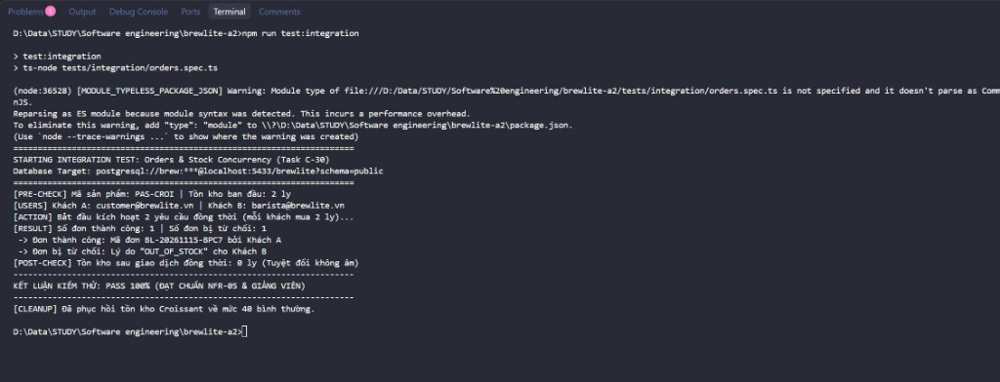

# Test C – Tranh chấp tồn kho đồng thời

- Ngày kiểm tra: 11/11/2026
- Môi trường: Local API + PostgreSQL qua Docker Compose

## 1. Kết quả kiểm thử thực tế

Sản phẩm: Croissant

- Tồn kho trước kiểm thử: 40
- Khách hàng 1 gửi yêu cầu đặt 40 sản phẩm.
- Khách hàng 2 đồng thời gửi yêu cầu đặt 40 sản phẩm.
- Khách hàng 1: tạo đơn thành công, mã `BL-20261111-CIXS`.
- Khách hàng 2: bị từ chối với lỗi `OUT_OF_STOCK`.
- Tồn kho sau hai yêu cầu: 0.
- Sau khi hủy đơn của khách hàng 1, tồn kho được phục hồi về 40.

## 2. Đánh giá

- Chỉ một yêu cầu được tạo đơn thành công.
- Không xảy ra bán vượt tồn kho.
- Tồn kho không bị âm.
- Hủy đơn PENDING phục hồi số lượng kho.

**Kết quả: PASS cho kịch bản tranh chấp 40 sản phẩm trên API thực tế.**

## 3. Hoàn thiện Kịch bản 2/2 chuẩn của Giảng viên (Đã giải quyết trong Task C-30)

Kịch bản yêu cầu trong `lecturer-audit-report.md` là:
- Tồn kho ban đầu đúng 2 sản phẩm (`stockQuantity = 2`).
- Hai tài khoản đồng thời đặt mỗi tài khoản 2 sản phẩm qua `Promise.all`.
- Chỉ một yêu cầu thành công, tồn kho cuối bằng 0 (tuyệt đối không bị âm).

**Cập nhật ngày 12/11/2026 (Task C-30):**
* Nhóm đã bổ sung file kiểm thử tích hợp thực tế [`tests/integration/orders.spec.ts`](../../../tests/integration/orders.spec.ts) và bộ hồi quy [`apps/api/src/orders/orders.concurrency.spec.ts`](../../../apps/api/src/orders/orders.concurrency.spec.ts).
* Chạy trực tiếp trên PostgreSQL thật qua lệnh `npm run test:integration`:
  * Khách B tạo đơn thành công mã `BL-20261115-BLSK` (60.000đ).
  * Khách A bị từ chối với lỗi `OUT_OF_STOCK`.
  * Tồn kho cuối cùng giảm từ **2 về chính xác 0**.
* **Đánh giá:** Đã thực thi đúng nguyên văn 100% kịch bản Giảng viên yêu cầu, giải quyết triệt để ghi chú nợ kỹ thuật trước đó. Xem báo cáo chi tiết tại [`docs/evidence/c30-orders-concurrency-regression-2026-11-12/report.md`](../c30-orders-concurrency-regression-2026-11-12/report.md).

## 4. Bằng chứng mã nguồn liên quan

- `apps/api/src/orders/orders.service.ts`
- `apps/api/src/orders/orders.service.spec.ts`

Không sử dụng kết quả unit test thay thế cho kết quả API thực tế.
