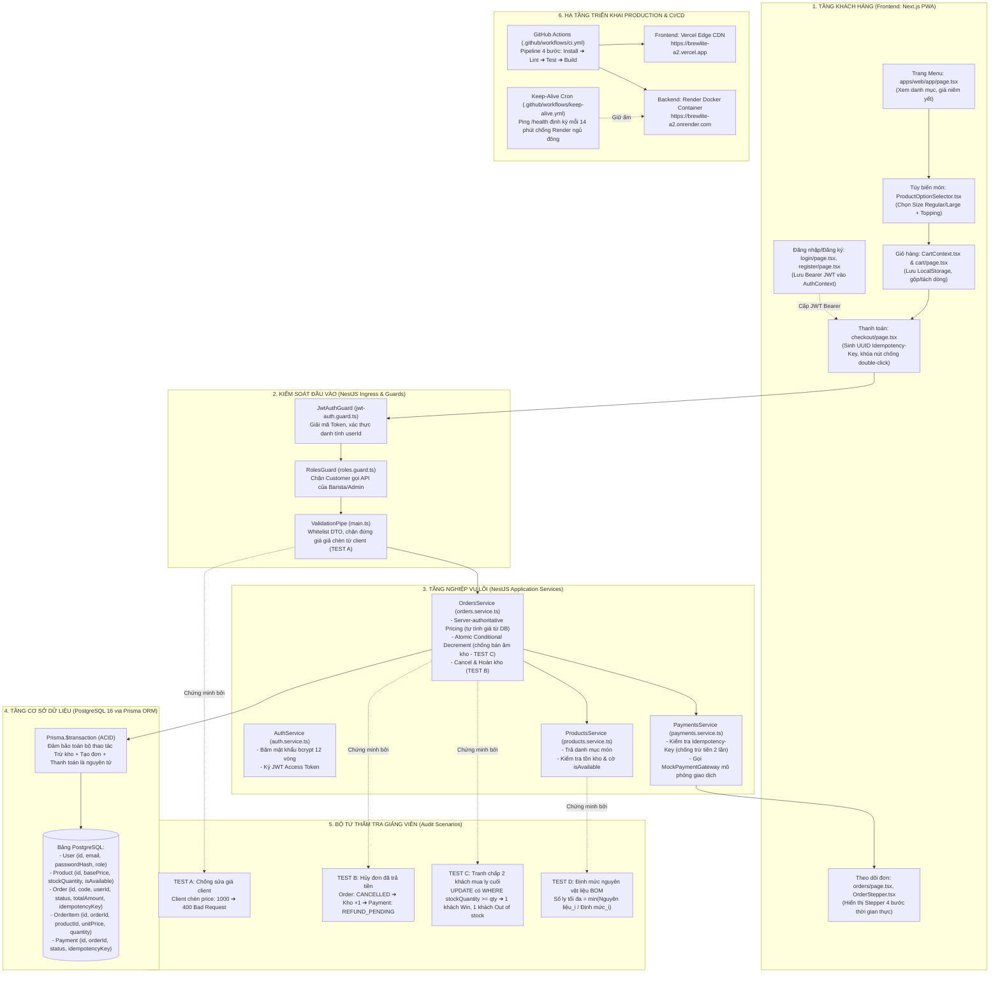

# BẢN ĐỒ TỔNG QUÁT CỰC ĐẠI: ĐỐI SOÁT TOÀN DIỆN A1 – A2 & VỊ TRÍ BỘ KIỂM THỬ
## (The Ultimate Master Blueprint: A1 vs A2, Architecture & Full Test Suite Map)

> **Dành cho:** Thành viên bảo vệ đồ án Công nghệ Phần mềm – ĐH Sài Gòn (SGU)  
> **Mục tiêu:** Xâu chuỗi toàn bộ hệ thống, xóa bỏ cảm giác "hiểu tùm lum", định vị chính xác từng file test và hiểu rõ sự tiến hóa từ A1 lên A2.

---

## 1. VÌ SAO BẠN BỊ CẢM GIÁC "HIỂU TÙM LUM"? VÀ ĐÂU LÀ "SỢI CHỈ ĐỎ"?

Bạn thấy rối vì trong đầu bạn đang bị lẫn lộn giữa:
1. Hai phiên bản đồ án (**A1** và **A2**) nằm ở hai thư mục khác nhau.
2. Nhiều tầng kỹ thuật (**Next.js, Zustand/Context, NestJS Controller, Guard, Service, Prisma, PostgreSQL**).
3. Hàng chục file test rải rác ở khắp nơi (`__tests__`, `spec.ts`, `tests/e2e`).

### 🗝️ "Sợi chỉ đỏ" duy nhất xâu chuỗi tất cả:
> **MỌI THỨ TRONG BREWLITE ĐỀU XOAY QUANH VÒNG ĐỜI CỦA 1 ĐƠN HÀNG.**  
> Nếu bạn bám chặt vào hành trình của 1 ly cà phê từ lúc khách bấm chọn $\to$ trừ kho $\to$ thanh toán $\to$ barista pha chế $\to$ hoàn tất (hoặc hủy đơn), bạn sẽ thấy **mọi file code và mọi file test đều sinh ra chỉ để phục vụ và bảo vệ hành trình này!**

---

## 2. SƠ ĐỒ TỔNG QUÁT CỰC DÀI (GIANT MASTER FLOWCHART)

Sơ đồ này mô tả toàn bộ vòng đời của hệ thống: từ Client $\to$ Gateways $\to$ Backend Modules $\to$ Database $\to$ Bộ kiểm thử $\to$ Triển khai Cloud.

---

## 3. BẢNG SO SÁNH ĐỐI ỨNG CHI TIẾT: BREWLITE A1 vs BREWLITE A2

| Tiêu chí | BrewLite A1 (`brewlite`) | BrewLite A2 (`brewlite-a2`) | Ý nghĩa kỹ nghệ phần mềm |
| :--- | :--- | :--- | :--- |
| **Cấu trúc Repo** | Hai thư mục tách rời: `backend/` và `frontend/`. | **Monorepo chuẩn npm workspaces:** `apps/api` và `apps/web`. | Tối ưu hóa việc chia sẻ types, quản lý dependencies tập trung và build CI đồng nhất. |
| **Kiểm soát ranh giới** | Dùng script tùy biến `verify-foundation.mjs` ép import qua `public.ts`. | Sử dụng **NestJS Modular Architecture** với module encapsulation chính thống (`exports`, `imports`). | Tuân thủ chuẩn kiến trúc doanh nghiệp, giảm sự phụ thuộc vào các script tùy biến tự viết. |
| **Phạm vi tính năng** | Dàn trải rộng: có cả Rewards, Loyalty Points, Voucher GIAM10, Quản lý kho nguyên liệu BOM. | **Tập trung sâu vào MVP:** Đặt món $\to$ Giỏ hàng $\to$ Thanh toán an toàn $\to$ Lịch sử đơn. Hoãn (`Deferred`) Voucher theo `api-contracts.md`. | Đúng tinh thần Agile: Ưu tiên hoàn thiện trọn vẹn luồng cốt lõi và tính toàn vẹn dữ liệu thay vì làm nhiều mà lỗi. |
| **Tài liệu & Truy vết** | User Stories cơ bản, các file tài liệu rời rạc, chưa có ma trận truy vết chính quy. | **Hệ thống 5 Task chuẩn mực:** SRS, PlantUML Diagrams, 5 ADRs, và **Traceability Matrix (`traceability-matrix.md`)**. | Đáp ứng yêu cầu Mục 8.1 của đề bài: Mọi chức năng và test case đều truy vết được 2 chiều về Use Case và Sơ đồ thiết kế. |
| **Hạ tầng triển khai** | Chủ yếu chạy cục bộ qua `docker-compose.yml`. | **Production Cloud 100% có HTTPS:** Vercel (PWA) + Render (NestJS Docker) + PostgreSQL Cloud + GitHub Keep-Alive Cron. | Chuyển từ "phần mềm chỉ chạy ở máy tôi" sang "hệ thống thực tế phục vụ người dùng có SLA và giám sát". |
| **Bộ kiểm thử** | Unit test rời rạc (chủ yếu Vitest cục bộ). | **128 tests pass 100%:** Jest cho Backend, Vitest cho Frontend, Playwright cho E2E, Supertest cho API Security. | Đảm bảo chất lượng nghiêm ngặt trước khi merge code vào `main`. |

---

## 4. TỌA ĐỘ VÀ BẢN ĐỒ VỊ TRÍ TOÀN BỘ FILE TEST

Dưới đây là "bản đồ tọa độ" của tất cả các bài test trong dự án. Khi Thầy Cô hỏi: *"Bài test này nằm ở đâu? Chạy như thế nào?"*, bạn chỉ cần tra bảng này:

### 4.1. Bộ kiểm thử Backend API (`apps/api/`) – Framework: Jest & Supertest
> **Lệnh chạy:** `npm run test --workspace @brewlite/api` (68 tests PASS)

| Mã Test | Đường dẫn file Test | Lệnh chạy riêng file đó | Mục tiêu kiểm thử & Ca lỗi phát hiện |
| :---: | :--- | :--- | :--- |
| `API-T01` | `apps/api/src/catalog/products.service.spec.ts` `apps/api/src/catalog/products.controller.spec.ts` | `npx jest src/catalog/products.service.spec.ts` | - Truy vấn menu đồ uống. - Xem chi tiết món theo ID. - Kiểm tra cờ `isAvailable` và số lượng tồn kho. |
| `API-T02` | `apps/api/src/auth/auth.security.spec.ts` `apps/api/src/auth/jwt.config.spec.ts` | `npx jest src/auth/auth.security.spec.ts` | - **Bảo mật:** Băm bcrypt 12 vòng, không lộ hash. - Chặn đăng ký trùng email (409 Conflict). - Chặn khách hàng tự gán quyền `ADMIN`/`BARISTA`. - Kiểm tra token hết hạn, sai chữ ký, thiếu Bearer header. |
| `API-T03` `INT-T01` | `apps/api/src/orders/orders.service.spec.ts` `apps/api/src/orders/orders.controller.spec.ts` `apps/api/src/orders/orders.security.spec.ts` | `npx jest src/orders/orders.service.spec.ts` | - **TEST A (Security):** Chặn client gửi trường `price: 1000` (400 Bad Request). - **TEST C (Concurrency):** Trừ kho nguyên tử, chặn 2 khách mua ly cuối cùng gây âm kho. - Chặn đơn hàng không có món (empty items). |
| `API-T04` | `apps/api/src/orders/orders.service.spec.ts` (L300+) | `npx jest src/orders/orders.controller.spec.ts` | - **State Machine:** Chuyển trạng thái đơn `PAID ➔ PREPARING ➔ READY ➔ COMPLETED`. - Chặn bước nhảy trạng thái sai (ví dụ: `PENDING ➔ COMPLETED`). - Phân quyền RBAC: Chỉ Staff mới được cập nhật trạng thái đơn. |
| `API-T06` `INT-T02` | `apps/api/src/payments/payments.service.spec.ts` `apps/api/src/payments/mock-gateway.service.spec.ts` | `npx jest src/payments/payments.service.spec.ts` | - **TEST B:** Hủy đơn đã thanh toán $\to$ hoàn trả tồn kho và chuyển payment sang `REFUND_PENDING`. - **Idempotency:** Bấm thanh toán 2 lần liên tiếp không bị trừ tiền 2 lần. - Xử lý khi tài khoản kết thúc bằng `0000` (mô phỏng lỗi giao dịch). |
| `SMOKE-01` | `apps/api/src/health/health.controller.spec.ts` | `npx jest src/health/health.controller.spec.ts` | - Kiểm tra endpoint `/health` trả về HTTP 200. - Xác nhận kết nối Database PostgreSQL đang sống (`status: ok, database: up`). |

---

### 4.2. Bộ kiểm thử Frontend Web (`apps/web/`) – Framework: Vitest & React Testing Library
> **Lệnh chạy:** `npm run test --workspace @brewlite/web` (60 tests PASS)

| Mã Test | Đường dẫn file Test | Lệnh chạy riêng file đó | Mục tiêu kiểm thử Component giao diện |
| :---: | :--- | :--- | :--- |
| `WEB-T01` | `apps/web/__tests__/menu.test.tsx` | `npx vitest run __tests__/menu.test.tsx` | - Hiển thị 3 trạng thái giao diện: **Loading**, **Empty** và **Error + Nút Thử lại (Retry)**. - Hiển thị danh sách sản phẩm và bộ lọc danh mục. |
| `WEB-T02` `WEB-T03` | `apps/web/__tests__/cart.test.tsx` | `npx vitest run __tests__/cart.test.tsx` | - Tùy biến size Regular/Large (+10.000đ) và Topping. - Giỏ hàng: Gộp dòng nếu cùng tùy biến, tách dòng nếu khác. - Tăng/giảm số lượng, xóa món, tính tổng tiền tức thì. - Payload gửi sang Checkout **tuyệt đối không kèm giá tiền của client**. |
| `WEB-T04` | `apps/web/__tests__/auth.test.tsx` | `npx vitest run __tests__/auth.test.tsx` | - Form Đăng nhập & Đăng ký: Validate email, số điện thoại. - Xử lý phản hồi lỗi từ server (401 Unauthorized, 409 Conflict). - Đồng bộ trạng thái đăng nhập trên Navbar. |
| `WEB-T05` | `apps/web/__tests__/checkout.test.tsx` | `npx vitest run __tests__/checkout.test.tsx` | - Chặn đặt hàng khi giỏ rỗng. - Sinh UUID v4 làm `Idempotency-Key`. - Vô hiệu hóa nút Submit (disabled) chống double-click. - Giữ lại `orderId` khi thanh toán thất bại để khách bấm thử lại mà không tạo đơn trùng. |
| `WEB-T06` | `apps/web/__tests__/orders.test.tsx` `apps/web/__tests__/order-detail.test.tsx` `apps/web/__tests__/order-stepper.test.tsx` | `npx vitest run __tests__/orders.test.tsx` | - Danh sách lịch sử đơn hàng của người dùng. - Chi tiết đơn hàng theo ID. - Thanh Stepper trực quan 4 bước: `PAID ➔ PREPARING ➔ READY ➔ COMPLETED`. - Xử lý quyền xem (chặn 401/403) và nút Thử lại khi mất mạng. |

---

### 4.3. Kiểm thử Tích hợp Toàn diện (End-to-End) – Framework: Playwright
> **Lệnh chạy:** `npx playwright test`

| Mã Test | Đường dẫn file Test | Lệnh chạy | Hành vi người dùng được mô phỏng tự động |
| :---: | :--- | :--- | :--- |
| `E2E-T01` | `tests/e2e/checkout-flow.spec.ts` | `npx playwright test tests/e2e/checkout-flow.spec.ts` | - Mở trình duyệt Chromium tự động. - Vào trang chủ $\to$ Chọn món Cà phê sữa đá $\to$ Thêm vào giỏ. - Chuyển sang Giỏ hàng $\to$ Bấm Đặt hàng $\to$ Điền form Checkout. - Bấm Thanh toán $\to$ Kiểm tra hiển thị màn hình thông báo Đặt hàng thành công và Stepper đơn hàng. |

---

## 5. CÔNG THỨC TRẢ LỜI "THẦY HỎI ĐÂU – CHỈ ĐÚNG ĐÓ"

Khi Thầy Cô đặt câu hỏi bất kỳ, hãy dùng "Bộ quy tắc phản xạ 3 bước":
1. **Bước 1 (Xác nhận yêu cầu):** *"Dạ thưa Thầy/Cô, yêu cầu này thuộc mã `FR-xx` (hoặc `NFR-xx`) trong Ma trận truy vết."*
2. **Bước 2 (Chỉ đúng sơ đồ & code):** *"Nó được thiết kế ở sơ đồ `docs/diagrams/...` và được hiện thực tại file `apps/...` ở dòng số `...`."*
3. **Bước 3 (Dẫn chứng bằng chứng kiểm thử):** *"Nhóm đã viết bài test tự động cho ca này tại file `apps/...spec.ts` (Mã test `...`), kết quả chạy thực tế pass 100% ạ."*
