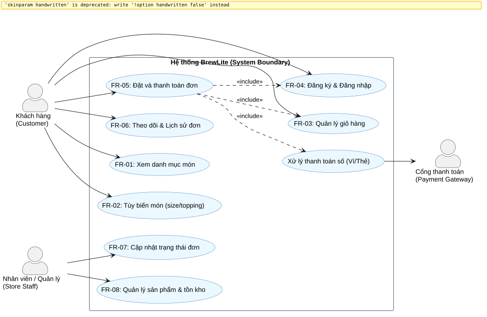

# Task 1.2 – Tài liệu Đặc tả Yêu cầu Phần mềm Rút gọn (SRS)

Tài liệu này đặc tả danh mục yêu cầu chức năng (FR) và phi chức năng (NFR) cho hệ thống **BrewLite**, được phân loại theo phương pháp **MoSCoW** kèm tiêu chí chấp nhận có thể kiểm chứng được (Acceptance Criteria).

---

## 1. Yêu cầu Chức năng (Functional Requirements - FR)

| Mã FR | Tên yêu cầu chức năng | Mô tả chi tiết | Mức ưu tiên (MoSCoW) | Tiêu chí chấp nhận (Acceptance Criteria) |
| :---: | :--- | :--- | :---: | :--- |
| **FR-01** | **Xem danh mục món (Menu Catalog)** | Người dùng có thể xem danh sách toàn bộ đồ uống được phân chia theo danh mục kèm hình ảnh, tên và giá niêm yết. | **Must** | **GIVEN** người dùng truy cập trang chủ hoặc trang menu **WHEN** hệ thống tải dữ liệu xong **THEN** hiển thị đầy đủ danh sách món với giá, hình ảnh và nhãn trạng thái còn/hết hàng. |
| **FR-02** | **Xem chi tiết & Tùy biến món** | Người dùng có thể xem chi tiết mô tả đồ uống, tùy chọn size (Regular, Large) và các loại topping kèm giá cộng thêm. | **Must** | **GIVEN** người dùng chọn một món bất kỳ **WHEN** chọn size Large (+10,000đ) hoặc thêm Trân châu (+5,000đ) **THEN** tổng giá tiền tạm tính của món được cộng dồn chính xác theo thời gian thực. |
| **FR-03** | **Quản lý giỏ hàng (Cart)** | Người dùng có thể thêm món vào giỏ hàng, cập nhật số lượng, xóa món và xem tổng tiền đơn hàng cần thanh toán. | **Must** | **GIVEN** giỏ hàng có sản phẩm **WHEN** người dùng thay đổi số lượng món hoặc xóa món **THEN** giỏ hàng cập nhật số lượng lập tức và tính lại tổng tiền chính xác; nếu giỏ trống thì hiển thị trạng thái Empty. |
| **FR-04** | **Xác thực người dùng (Auth & JWT)** | Khách hàng có thể đăng ký tài khoản mới bằng Email/Mật khẩu và đăng nhập để nhận JWT Token. | **Must** | **GIVEN** thông tin đăng nhập hợp lệ **WHEN** gửi request `POST /auth/login` **THEN** nhận được mã HTTP 200/201 kèm JWT Bearer access token; nếu sai mật khẩu nhận mã HTTP 401. |
| **FR-05** | **Tạo đơn hàng & Thanh toán mô phỏng** | Người dùng đã đăng nhập có thể gửi đơn hàng từ giỏ hàng và thực hiện thanh toán qua Ví điện tử hoặc Thẻ mô phỏng. | **Must** | **GIVEN** giỏ hàng có món và người dùng đã xác thực JWT **WHEN** thực hiện thanh toán với Idempotency Key **THEN** đơn hàng được lưu vào Database trong một transaction, trạng thái đơn chuyển sang `PAID` và sinh mã Order Code. |
| **FR-06** | **Theo dõi & Xem lịch sử đơn** | Người dùng có thể tra cứu chi tiết đơn hàng vừa đặt và xem lại danh sách toàn bộ các đơn hàng trong quá khứ. | **Must** | **GIVEN** người dùng đã đăng nhập tài khoản **WHEN** truy cập mục Lịch sử đơn hàng **THEN** hiển thị danh sách các đơn hàng đã đặt kèm trạng thái, ngày đặt và tổng số tiền. |
| **FR-07** | **Cập nhật trạng thái đơn hàng (Store Staff)** | Nhân viên cửa hàng có thể cập nhật trạng thái đơn hàng từ `PAID` sang `PREPARING` ➔ `READY` ➔ `COMPLETED`. | **Should** | **GIVEN** nhân viên có quyền quản lý đơn hàng **WHEN** gọi API cập nhật trạng thái đơn sang `READY` **THEN** trạng thái đơn được ghi nhận thay đổi trong cơ sở dữ liệu và phản ánh tức thì trên hệ thống. |
| **FR-08** | **Áp dụng mã ưu đãi (Promotion)** | Người dùng có thể nhập mã giảm giá khi thanh toán để được khấu trừ số tiền đơn hàng theo chính sách khuyến mãi. | **Could** | **GIVEN** mã giảm giá hợp lệ và còn hạn sử dụng **WHEN** người dùng áp dụng mã vào đơn hàng **THEN** tổng tiền thanh toán được trừ đi giá trị ưu đãi tương ứng trước khi thanh toán. |

---

## 2. Yêu cầu Phi Chức năng (Non-Functional Requirements - NFR)

| Mã NFR | Nhóm yêu cầu | Đặc tả kỹ thuật | Mức ưu tiên | Tiêu chí chấp nhận (Acceptance Criteria) |
| :---: | :--- | :--- | :---: | :--- |
| **NFR-01** | **Hiệu năng (Performance)** | • Thời gian phản hồi của API `GET /products` và `POST /orders` $\le 500\text{ms}$ trong điều kiện thông thường. • Điểm Lighthouse Performance của Frontend Next.js $\ge 80$. | **Must** | Đo kiểm qua smoke test và vitest: 95% request API đạt thời gian phản hồi dưới 500ms. |
| **NFR-02** | **Bảo mật (Security)** | • Mật khẩu người dùng được băm an toàn bằng thuật toán Argon2 hoặc Bcrypt trước khi lưu database. • API được bảo vệ bằng JWT Bearer Token, kiểm tra quyền truy cập. • Tự động validate dữ liệu đầu vào qua NestJS ValidationPipe (DTO). • Không lưu trữ Secret / Token trong mã nguồn Git. | **Must** | Chạy automated test kiểm tra password hash; request không có JWT bị chặn mã 401; quét git không có secret lộ lọt. |
| **NFR-03** | **Tính khả dụng & Trải nghiệm (Usability)** | • Giao diện tối ưu Mobile-first PWA, tương thích tốt trên màn hình điện thoại (375px - 430px) và desktop. • Thể hiện đầy đủ 3 trạng thái giao diện: **Loading** (skeleton/spinner), **Empty** (khi không có dữ liệu) và **Error** (khi mất mạng/lỗi server kèm nút Retry). | **Must** | Kiểm thử giao diện trên các kích thước màn hình responsive và ngắt kết nối mạng để xác nhận thông báo lỗi thân thiện. |
| **NFR-04** | **Khả năng triển khai & Tin cậy (Deployability)** | • Toàn bộ backend, frontend và database có thể chạy độc lập qua Docker Compose. • Backend cung cấp endpoint `GET /health` trả về trạng thái `200 OK` kèm kiểm tra kết nối Database. • Pipeline CI/CD tự động kiểm tra code và triển khai lên Production. | **Must** | Gọi `curl -I https://<api-domain>/health` nhận HTTP 200; `docker compose up` khởi chạy thành công 3 container. |
| **NFR-05** | **Toàn vẹn dữ liệu (Data Integrity)** | • Sử dụng **Database Transaction** (`prisma.$transaction`) khi tạo đơn và trừ tồn kho để đảm bảo nguyên lý ACID. • Hỗ trợ **Idempotency** khi gửi yêu cầu thanh toán nhiều lần. | **Must** | Integration test gửi 2 request trùng Idempotency-Key: hệ thống chỉ tạo duy nhất 1 đơn hàng và trả về cùng mã đơn. |

---

## 3. Sơ đồ Use-case Tổng quát Toàn hệ thống (System Use-case Diagram)

Sơ đồ thể hiện tương tác giữa 3 Actor chính: **Khách hàng (Customer)**, **Nhân viên / Quản lý (Store Staff)** và **Cổng thanh toán mô phỏng (Payment Gateway)**.

*File mã nguồn PlantUML: [`docs/diagrams/use-case-system.puml`](../diagrams/use-case-system.puml)*
