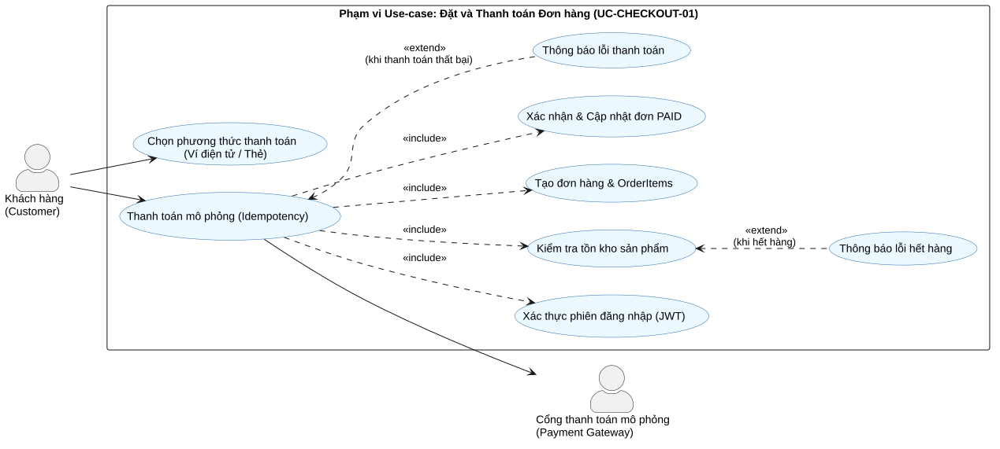

# Task 1.3 – Đặc tả Use-case Trọng tâm: "Đặt và Thanh toán Đơn hàng"

Use-case này có giá trị nghiệp vụ cốt lõi nhất trong hệ thống BrewLite, liên kết trực tiếp giữa trải nghiệm khách hàng và doanh thu của quán.

---

## 1. Sơ đồ Use-case Chi tiết (Use-case Diagram)

*File mã nguồn PlantUML: [`docs/diagrams/use-case-checkout.puml`](../diagrams/use-case-checkout.puml)*

---

## 2. Bảng Mô tả Đặc tả Use-case (Use-case Specification)

| Thuộc tính | Chi tiết đặc tả |
| :--- | :--- |
| **Tên Use-case** | **Đặt và thanh toán đơn hàng (Place Order & Checkout)** |
| **Mã định danh** | `UC-CHECKOUT-01` |
| **Actor chính** | Khách hàng (Customer) |
| **Actor phụ** | Cổng thanh toán mô phỏng (Payment Gateway Service) |
| **Trigger (Tác nhân kích hoạt)** | Khách hàng bấm nút **"Tiến hành đặt hàng"** từ màn hình Giỏ hàng. |
| **Tiền điều kiện (Pre-conditions)** | 1. Giỏ hàng của khách hàng có ít nhất một sản phẩm hợp lệ. 2. Khách hàng đã đăng nhập và sở hữu JWT Token hợp lệ. |
| **Hậu điều kiện thành công (Post-conditions - Success)** | 1. Đơn hàng được tạo thành công trong Database với trạng thái `PAID`. 2. Giao dịch thanh toán được ghi nhận kèm mã tham chiếu giao dịch (`transactionRef`). 3. Tồn kho nguyên liệu/sản phẩm được cập nhật chính xác. 4. Giỏ hàng hiện tại của khách hàng được xóa rỗng. 5. Màn hình xác nhận đơn hàng hiển thị mã đơn và chi tiết đơn hàng cho khách. |
| **Hậu điều kiện thất bại (Post-conditions - Failure)** | 1. Không có đơn hàng nào được ghi nhận hoặc đơn chuyển trạng thái `PAYMENT_FAILED`. 2. Không có tiền bị trừ, tồn kho giữ nguyên trạng thái ban đầu. 3. Giỏ hàng của khách hàng vẫn được bảo lưu để khách có thể thử lại. |
| **Mã yêu cầu liên kết** | `FR-03` (Giỏ hàng), `FR-04` (Xác thực), `FR-05` (Tạo đơn & Thanh toán), `NFR-01`, `NFR-02`, `NFR-05`. |

---

## 3. Các Luồng Nghiệp vụ (Scenario Flows)

### 3.1. Luồng chính (Main Flow - Happy Path)
1. **Khách hàng** xem lại danh sách sản phẩm, số lượng và tổng tiền trong Giỏ hàng, sau đó bấm nút **"Đặt hàng"**.
2. **Next.js UI** kiểm tra trạng thái xác thực: nhận thấy khách hàng đã đăng nhập với JWT hợp lệ.
3. **Next.js UI** hiển thị màn hình Thanh toán (Checkout Screen) gồm: Tóm tắt đơn hàng, lựa chọn phương thức thanh toán (Ví điện tử hoặc Thẻ ngân hàng mô phỏng), và ghi chú đơn hàng.
4. **Khách hàng** chọn phương thức thanh toán (mặc định: Ví điện tử BrewPay) và bấm **"Xác nhận thanh toán"**.
5. **Next.js UI** tự động sinh một mã `Idempotency-Key` duy nhất (UUID v4) và gửi request `POST /orders/checkout` kèm JWT Bearer Token lên **NestJS API**.
6. **NestJS API** xác thực JWT, giải mã thông tin `userId`, và kiểm tra payload DTO.
7. **NestJS API** khởi tạo một **Database Transaction** (`prisma.$transaction`):
   * Kiểm tra tình trạng tồn kho của các sản phẩm trong giỏ hàng (tất cả còn hàng).
   * Tạo bản ghi `Order` với mã đơn `BL-XXXX` và trạng thái tạm `PENDING`.
   * Tạo các bản ghi chi tiết `OrderItem` kèm snapshot đơn giá và tùy chọn size/topping.
8. **NestJS API** gửi yêu cầu xử lý trừ tiền sang **Payment Gateway Service** kèm số tiền và `Idempotency-Key`.
9. **Payment Gateway Service** xử lý giao dịch thành công và trả về mã tham chiếu giao dịch `TX-XXXX` kèm trạng thái `SUCCESS`.
10. **NestJS API** cập nhật trạng thái đơn hàng sang `PAID`, lưu bản ghi `Payment`, cập nhật trừ tồn kho và hoàn tất transaction (Commit).
11. **NestJS API** trả về response HTTP 201 Created kèm dữ liệu chi tiết đơn hàng.
12. **Next.js UI** xóa sạch giỏ hàng trong local state, chuyển hướng khách hàng sang màn hình **Xác nhận đơn hàng (Order Confirmation)** và hiển thị mã đơn hàng để theo dõi.

---

### 3.2. Luồng thay thế (Alternative Flows)
* **Alt-1: Khách hàng chọn thanh toán qua Thẻ ngân hàng mô phỏng (Bank Card):**
  * Tại bước 4, khách hàng chọn tab "Thẻ ngân hàng".
  * Khách hàng nhập số thẻ mô phỏng (VD: `4111 1111 1111 1111`) và ngày hết hạn.
  * Hệ thống chuyển thông tin thẻ đến Payment Gateway để xử lý theo luồng Thẻ và tiếp tục từ bước 9 của luồng chính.
* **Alt-2: Khách hàng áp dụng mã giảm giá hợp lệ:**
  * Tại bước 4, khách hàng nhập mã ưu đãi (VD: `BREWNEW10`) và bấm áp dụng.
  * Hệ thống kiểm tra điều kiện mã, tính số tiền giảm và hiển thị lại tổng tiền sau giảm giá trước khi thực hiện bước thanh toán.

---

### 3.3. Luồng ngoại lệ (Exception Flows)
* **Exc-1: Khách hàng chưa đăng nhập:**
  * Tại bước 2, nếu chưa có JWT Token, Next.js UI lưu lại trạng thái giỏ hàng vào LocalStorage và chuyển hướng khách hàng đến màn hình Đăng nhập (`/auth/login`) kèm tham số redirect về giỏ hàng sau khi đăng nhập thành công.
* **Exc-2: Sản phẩm bị hết hàng trong lúc đặt:**
  * Tại bước 7, khi kiểm tra tồn kho trong Transaction, hệ thống phát hiện sản phẩm đã hết hàng.
  * Transaction tự động **Rollback**, không có đơn hàng nào được tạo.
  * NestJS API trả về mã lỗi HTTP 400 Bad Request kèm thông báo: *"Sản phẩm [Tên sản phẩm] hiện đã hết hàng, vui lòng cập nhật lại giỏ hàng"*.
  * Next.js UI hiển thị thông báo lỗi nổi bật và đánh dấu sản phẩm hết hàng trong giỏ.
* **Exc-3: Thanh toán bị từ chối / Thất bại:**
  * Tại bước 9, Payment Gateway trả về lỗi (số dư ví không đủ hoặc thẻ bị từ chối).
  * NestJS API cập nhật trạng thái đơn hàng sang `PAYMENT_FAILED` hoặc Rollback, ghi nhận log giao dịch lỗi.
  * API trả về mã lỗi HTTP 402 Payment Required.
  * Next.js UI thông báo: *"Thanh toán không thành công. Giỏ hàng của bạn vẫn được giữ nguyên, vui lòng thử lại hoặc chọn phương thức khác."*
* **Exc-4: Client retry do rớt mạng (Idempotency Trigger):**
  * Do mạng chập chờn, khách hàng nhấn nút xác nhận nhiều lần hoặc trình duyệt tự động gửi lại request với cùng `Idempotency-Key`.
  * NestJS API phát hiện key đã tồn tại trong cache/database và đơn hàng đã được xử lý thành công trước đó.
  * Hệ thống bỏ qua việc trừ tiền lần hai và trả về ngay kết quả của đơn hàng ban đầu với mã HTTP 200 OK.
